  

<h1 align="center">Hussain Awan | Web Developer in Pakistan 👋</h1>

<b>WordPress · Shopify · WooCommerce · React · AI Automation</b>

  
  
  

I'm Hussain Awan, a Web Developer and BS Computer Science student based in Pakistan. I build useful browser tools and responsive WordPress, WooCommerce, and Shopify experiences, with a focus on clean interfaces, accessibility, and practical problem-solving.

<b>Quick try:</b> <a href="https://mhussain-codes.github.io/day-01-image-under-100kb/">Compress an image to fit a 100 KB limit</a>

## 🧰 Tools I use and explore

   

## ✨ Selected projects
| Project | Focus | Link |
|---|---|---|
| **Invoice Simple** | Create clean invoices with live totals and PDF export | [Live](https://mhussain-codes.github.io/day-03-invoice-maker/) · [Code](https://github.com/mhussain-codes/day-03-invoice-maker) |
| **JSON Desk** | Format and validate JSON in your browser | [Live](https://mhussain-codes.github.io/day-02-json-formatter/) · [Code](https://github.com/mhussain-codes/day-02-json-formatter) |
| **Image Under 100 KB** | Private image compression for upload limits | [Try it](https://mhussain-codes.github.io/day-01-image-under-100kb/) · [Code](https://github.com/mhussain-codes/day-01-image-under-100kb) |
| **README Atelier** | Animated GitHub profile README builder | [Live](https://mhussain-codes.github.io/readme-atelier/) · [Code](https://github.com/mhussain-codes/readme-atelier) |
| **POSTER / LAB** | Generative posters with shareable seeds | [Live](https://mhussain-codes.github.io/pixel-poster-lab/) · [Code](https://github.com/mhussain-codes/pixel-poster-lab) |
| **Focus Flow** | Pomodoro timer for focused study | [Live](https://mhussain-codes.github.io/focus-flow/) · [Code](https://github.com/mhussain-codes/focus-flow) |
| **WordPress Page Audit** | On-page SEO and accessibility checks | [Live](https://mhussain-codes.github.io/wordpress-page-audit/) · [Code](https://github.com/mhussain-codes/wordpress-page-audit) |
| **Color Contrast Checker** | WCAG contrast checks and color previews | [Live](https://mhussain-codes.github.io/color-contrast-checker/) · [Code](https://github.com/mhussain-codes/color-contrast-checker) |
| **CSV Cleanroom** | Clean messy CSV files privately in your browser | [Demo](https://mhussain-codes.github.io/day-04-csv-cleanroom/) · [Code](https://github.com/mhussain-codes/day-04-csv-cleanroom) |
| **Screenshot Studio** | Annotate, redact, crop, and export screenshots locally | [Demo](https://mhussain-codes.github.io/day-05-screenshot-studio/) · [Code](https://github.com/mhussain-codes/day-05-screenshot-studio) |

<i>Design · build · learn · repeat</i>

