  

<h1 align="center">Hussain Awan | Web Developer in Pakistan 👋</h1>

<b>WordPress · Shopify · WooCommerce · React · AI Automation</b>

  
  
  

I'm Hussain Awan, a Web Developer and BS Computer Science student based in Pakistan. I build useful browser tools and responsive WordPress, WooCommerce, and Shopify experiences, with a focus on clean interfaces, accessibility, and practical problem-solving.

<b>Quick try:</b> <a href="https://mhussain-codes.github.io/day-01-image-under-100kb/">Compress an image to fit a 100 KB limit</a>

## 🧰 Tools I use and explore

   

## ✨ Selected projects

| Project | Focus | Link |
|---|---|---|
| **Fairshare** | Split shared expenses and get a clear settlement plan | [Demo](https://mhussain-codes.github.io/day-18-fairshare/) · [Code](https://github.com/mhussain-codes/day-18-fairshare) |
| **Packlight** | Build a tailored trip packing checklist and track progress | [Demo](https://mhussain-codes.github.io/day-17-packlight/) · [Code](https://github.com/mhussain-codes/day-17-packlight) |
| **Renewal Radar** | Track subscriptions, monthly costs, and upcoming renewals | [Demo](https://mhussain-codes.github.io/day-16-renewal-radar/) · [Code](https://github.com/mhussain-codes/day-16-renewal-radar) |
| **Pocket Relay** | Reopen a saved chat across phone and laptop with a short link | [Live](https://pocket-relay-steel.vercel.app/) · [Code](https://github.com/mhussain-codes/day-13-pocket-relay) |
| **SafePaste** | Mask common private details before sharing text | [Demo](https://mhussain-codes.github.io/day-12-private-redactor/) · [Code](https://github.com/mhussain-codes/day-12-private-redactor) |
| **Invoice Simple** | Create invoices with live totals and PDF export | [Demo](https://mhussain-codes.github.io/day-03-invoice-maker/) · [Code](https://github.com/mhussain-codes/day-03-invoice-maker) |
| **WordPress Page Audit** | Review on-page SEO and accessibility basics | [Demo](https://mhussain-codes.github.io/wordpress-page-audit/) · [Code](https://github.com/mhussain-codes/wordpress-page-audit) |
| **Color Contrast Checker** | Check accessible contrast between two colors | [Demo](https://mhussain-codes.github.io/color-contrast-checker/) · [Code](https://github.com/mhussain-codes/color-contrast-checker) |

<i>Design · build · learn · repeat</i>

